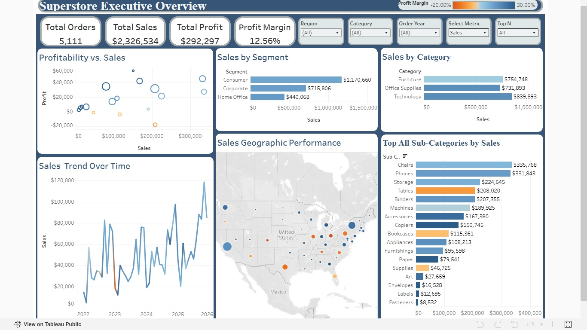

# Superstore Executive Overview — Sales & Profitability Analysis

An end-to-end data analysis and visual storytelling project examining Superstore sales, profit, and profit margin performance across segments, categories, sub-categories, regions, and time using an interactive **Tableau Dashboard** and an **8-scene Tableau Story**.

## Live Interactive Dashboard & Story
* **Tableau Public Link:** [View Interactive Dashboard & Story on Tableau Public](https://public.tableau.com/app/profile/sara.sayed4276/viz/Superstore_Executive_Overview_17954662441650/SuperstorePerformance)

* **Dashboard Walkthrough Video:** [Watch Dashboard & Story Walkthrough](https://drive.google.com/file/d/16uugC02U9D7C4kk1qGEy8CWdU79xcg4R/view?usp=drivesdk)

## Executive KPIs Snapshot
* **Total Orders:** 5,111
* **Total Sales:** $2,326,534
* **Total Profit:** $292,297
* **Overall Profit Margin:** 12.56%

## Dashboard & Story Highlights
* **Interactive Controls:** Dynamic filtering by `Region`, `Category`, and `Order Year`, paired with `Select Metric` (`Sales` / `Profit`) and `Top N` controls.
* **Core Visuals:** KPI summary cards, Profitability vs. Sales scatter view, Sales by Segment, Sales by Category, Sales Geographic Performance, Sales Trend Over Time, and Top Sub-Categories by Sales.
* **8-Scene Story Walkthrough:** Structured narrative progression starting from the executive overview (`1. Executive Overview: $2.33M Sales & $292.3K Net Profit (12.56% Margin) Across 5,111 Orders`) through time trajectory (`2. Revenue & Profit Trajectory Over Time (2022–2026)`), regional/segment/category breakdowns, profitability drivers, and interactive exploration.

## Repository Contents
* `Superstore_Executive_Overview.twbx` — Packaged Tableau workbook containing data, sheets, dashboard, and story.
* `superstore_dashboard_overview.jpg` — Dashboard overview screenshot.
* `README.md` — Project overview and documentation.
